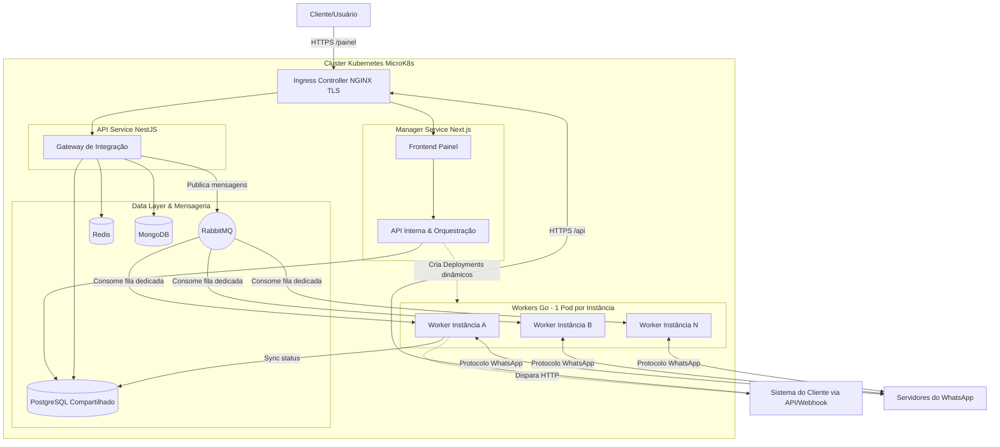

# Arquitetura do Sistema UzAPI

A arquitetura do UzAPI foi desenhada visando alta disponibilidade, isolamento de processos (sandbox por instância de WhatsApp) e deployment declarativo.

## Diagrama Geral da Arquitetura

## Componentes Chave

### 1. K8s Dinâmico (Manager Service)
O **Manager Service** utiliza as credenciais locais (`KUBECONFIG_PATH` apontando para o MicroK8s) para instanciar dinamicamente novos Pods de `worker-go` sob demanda de cada cliente. Assim, garante-se que, se uma sessão cair ou corromper, não afetará os demais clientes.

### 2. Mensageria Desacoplada (RabbitMQ)
As APIs (`api-service`) não interagem diretamente com o `worker-go` de forma síncrona para envio de mensagens. Elas depositam comandos (via RabbitMQ) em uma fila específica cujo nome é o `PHONE_NUMBER_ID` da instância correspondente.
O `worker-go` consome essa fila de forma isolada, controlando também mensagens com "delay" (via plugin `x-delayed-message` do RabbitMQ).

### 3. Gerenciamento de Estado (Bancos de Dados)
- **PostgreSQL**: Onde repousa o núcleo das informações. O Manager usa o Prisma/Drizzle para as tabelas principais de usuários e billing. O Worker utiliza uma tabela compartilhada (`public.instances` e `public.instance_realtime_state`) atualizando o status em realtime (usando UPSERT + NOTIFY trigger).
- **SQLite (No Worker)**: O pacote `whatsmeow` requer persistência atômica e rápida do device store criptográfico, mensagens e mídias. Para isso, há 1 arquivo `.db` gerado dinamicamente dentro de cada Pod.
- **MongoDB & Redis**: Utilizados pelo NestJS (`api-service`) para controle de cache, taxa limites (rate limit) ou modelagem flexível de logs e analíticos das integrações.

### 4. GitOps e Fluxo de Deploy
Toda a infraestrutura do MicroK8s e seus serviços essenciais é mantida via ArgoCD (padrão App of Apps). A ordem de deploy (Sync Waves) assegura que recursos de Storage (PVC) sejam criados primeiro, depois Bancos (PG, Redis, RabbitMQ), seguidos pelos serviços (Manager e então API).
